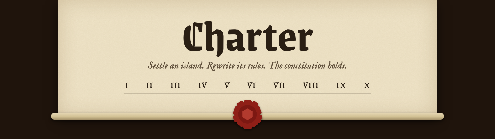
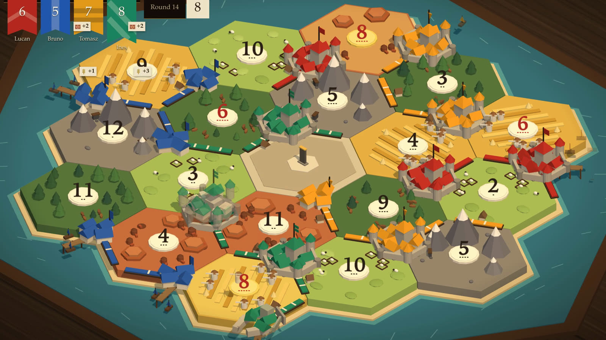
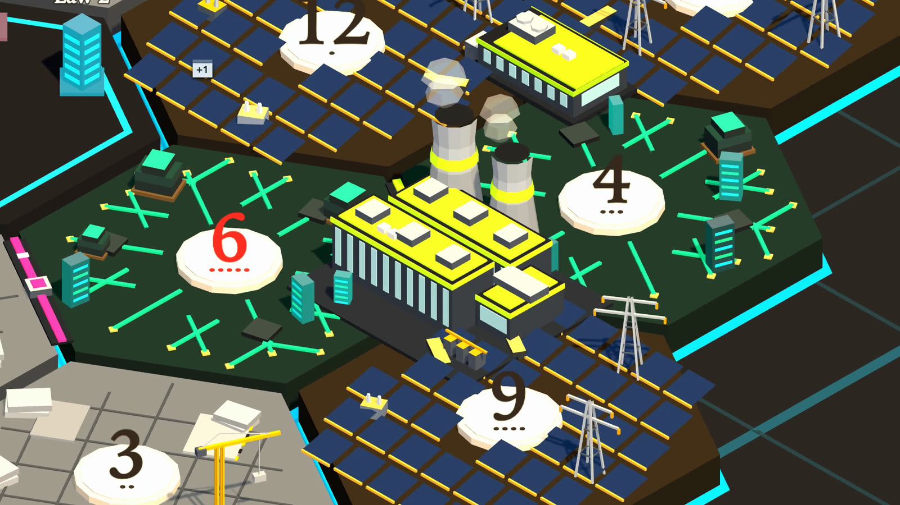
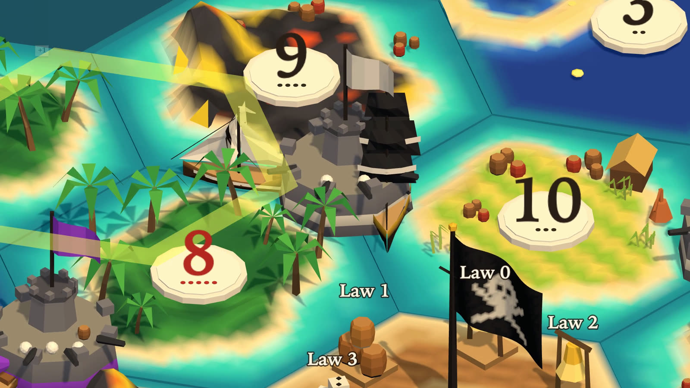
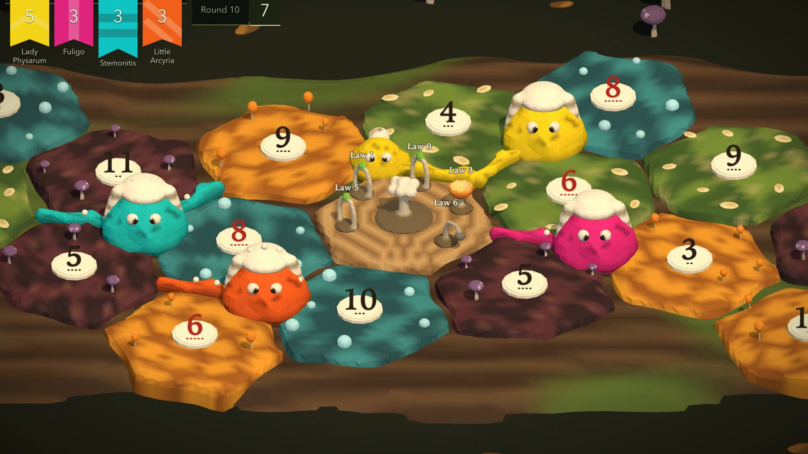

Charter is a multiplayer tabletop economy game with a fixed constitution and an evolving ruleset.

If you've played Catan, Charter will feel familiar. Now imagine that Catan guaranteed a set of fairness\* properties nobody could change, and let players add any rule they can describe. You write a rule in plain English, the clerk (Claude) drafts it as a law, and the table votes. If it passes, it runs.

\*Fairness here means whatever the constitution says.

<details>
<summary><strong>The constitution</strong></summary>

1. Nothing comes from nowhere.
2. The game plays no favourites.
3. Only a majority can change the rules.
4. Deals are paid up front.
5. Only you or a rule in force can move what's yours.
6. Every deal ends.
7. A build costs its price, plus what rules add.
8. Nobody can change a roll.
9. Nobody can stall the game.
10. What you vote on is what runs.

*Not promised: a fair game or a kind table.*

</details>

Charter is inspired by:

- **Catan**, for its complexity, its table talk and its fun gameplay loop.
- **SimCity and Civ**, for a 3D isometric board that seems to grow on its own as you play.
- **Paradox games, RimWorld and Dwarf Fortress**, for the stories that emerge.
- **Nomic**, for obvious reasons.

## Play it

**[Play Charter here](https://charter-preview.parthavshergill.workers.dev).** It's free and needs no account. Like Among Us, you share a game code with your friends. If you're short a player, Claude can take a seat. I think it's pretty fun.

Start with **Not Catan** if you've played Catan, or **Tutorial Island** if you're new to the genre. Then try the extensions in the Library: **The AI Bubble**, **The Pirate Republic**, **Strike the Earth** (inspired by Dwarf Fortress) and **Slime Parliament** (because why not). More are coming soon.

 
 

The development philosophy is experimental too. Fork it, and remix it into the version of Charter that you and your friends want to play. [This guide](docs/process/reskins.md) shows you how to make a new world.

## Why Lean

The kicker, for those who care, is that the game is written in Lean. There are three reasons, of varying quality:

1. **Lean suits small game engines written by AI.** You can prove theorems about the actual engine code, not a model of it.

2. **It's what makes the core loop possible.** A law is data in a small rule language, and the engine runs it. The theorems cover every law that language can express, including ones nobody has thought of yet. So a player can invent a rule mid-game, the clerk can draft it, and the promises still hold with no new proof. The clerk can get your rule wrong, but it can't write a law that breaks the constitution. The language has no way to say one. A law can't even name a player.

3. **[Vibecheck](https://fmxai.org/vibecheck/).** Charter was built for this formal methods hackathon, so it's also a way to explore what's possible when you build regular software from scratch in Lean. The constitution's theorems matter for the game's correctness. Nearly everything else, including the server, is written in Lean by AI for no good reason. In the [paraphrased] words of Donald Knuth: "This might be proofslop, but at least there's proofs?"

## What you have to trust

- **The constitution.** Read the [theorems](Charter/Constitution.lean) and the definitions they use. That's about 2,900 lines, and they are the part that matters.
- **Lean itself.** It checks the proofs.

You don't have to trust the engine, because the theorems are about its code. Nothing proves the server, the screen or the clerk's drafting. `make audit` checks all 2,800 theorems, but they haven't been through Comparator yet.

[The full list](docs/process/trusted-surface.md) has the fine print.

## How the other bits work

- **The board** is drawn by three.js from a stream of commands that Lean sends. A world's look is data in Lean, too. The menus and panels are about 2,400 lines of JavaScript.
- **Build checks** cover what doesn't need a full proof. Lean's `#guard` and similar checks stop the build if a piece has no model, a board goes over its triangle budget, or a shipped extension pack's rules aren't valid.

## Run it yourself

You need [elan](https://github.com/leanprover/elan), which installs Lean.

```bash
git clone https://github.com/parthavshergill/charter.git
```

```bash
cd charter
```

```bash
make install && make run
```

Then open <http://127.0.0.1:8787>. To use the clerk or Claude seats, put `ANTHROPIC_API_KEY=...` in a file named `.env`. Without a key, bots can fill the seats, and you can write laws in the rule language yourself.
