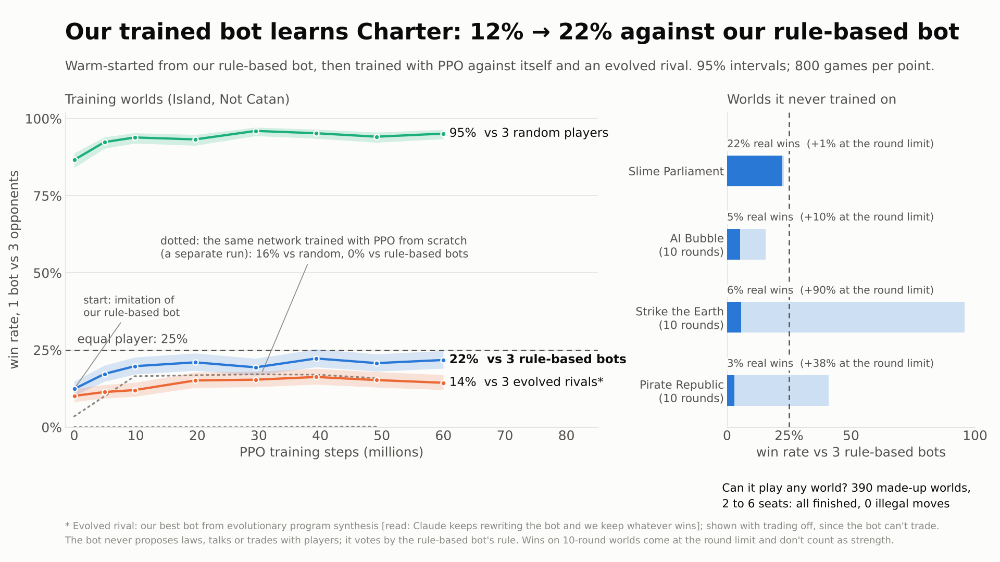

# Hero plot

How often the trained Charter policy wins against three opponents of each kind, across one training run's
checkpoints. Each point is `rl/eval` on the same seeds.



## What the policy is

- **Network:** `entity2`'s entity encoder (E 32) with a pointer over placements and bank trades, MinGRU 128, and
  170,016 weights. Layout version 2, so it plays any game that passes `G.Valid`, at 2 to 6 seats.
- **Warm start:** behaviour cloning of `hand`, our rule-based bot. This is step 0 on the plot. It is not "from
  scratch".
- **Then PPO:** self-play, with bot opponents in some games. It plays moves only. It never proposes laws, talks, or
  makes or accepts offers. Its votes follow `hand`'s rule.
- **Evolved rival:** `champion` is the best strategy from an evolution run (weights plus strategy rewrites, kept
  when they won in the arena). The plot uses `champion-closed`, which makes and accepts no offers, because the
  policy has no offer action.

## Files

| File | What it does |
|---|---|
| `stage.sh` | Copies checkpoints to `/vol/hero/ckpt/<run>/` on volume `charter-rl`, each with its own meta, so eval never touches the training agents' folders |
| `fetch.sh` | Downloads finished eval reports from `/vol/hero/<run>/e<step>/` and writes `data/eval.csv` and `data/can_play.txt` |
| `collect.py` | `report.json` to CSV: one row per checkpoint, game and opponent, with wins, target wins and round-limit wins |
| `plot.py` | Draws `hero.png`, `hero-dark.png` and `hero.svg` from `data/` |
| `seat.py` | An HTTP client for one seat at a local server (PR #31, `CHARTER_BOT=policy`), used by the Sonnet games. `--mode restricted` gives the seat only the policy's moves |
| `data/sonnet.csv` | Results of the Sonnet games |

## How to reproduce

```bash
rl/hero/stage.sh entity2/v2-fix/ckpt/charter/1793572064307 1 "<train args>" 0 4915200 ...
```

```bash
cd rl && CHARTER_RL_NAME=hero modal run modal_app.py --action eval --run hero/v2-fix --eval-name e<16-digit step> \
  --subjects hero/ckpt/v2-fix/<16-digit step>.bin --games 400 --quick --opponents hand,random,champion-closed,champion
```

```bash
rl/hero/fetch.sh /tmp/hero-reports && python3 rl/hero/plot.py
```

Eval runs on Modal CPU containers (8 CPUs each), with no GPU. `rl/entity/policy.py` and `entity_numpy.py` are copied
from `rl/entity2` so that `rl/eval` on `rl-harness` can load entity checkpoints.
